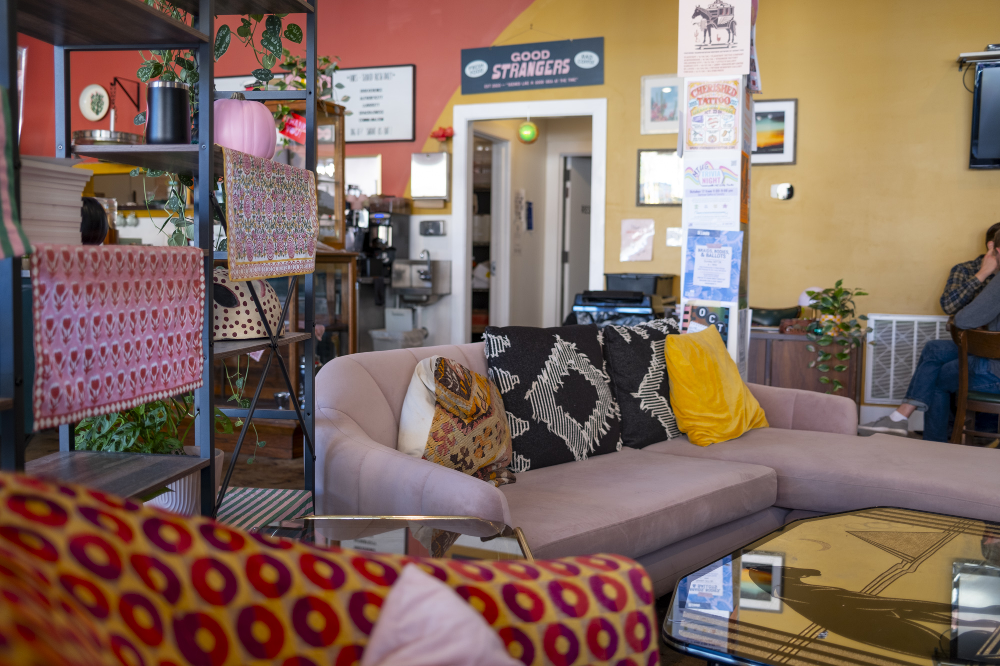
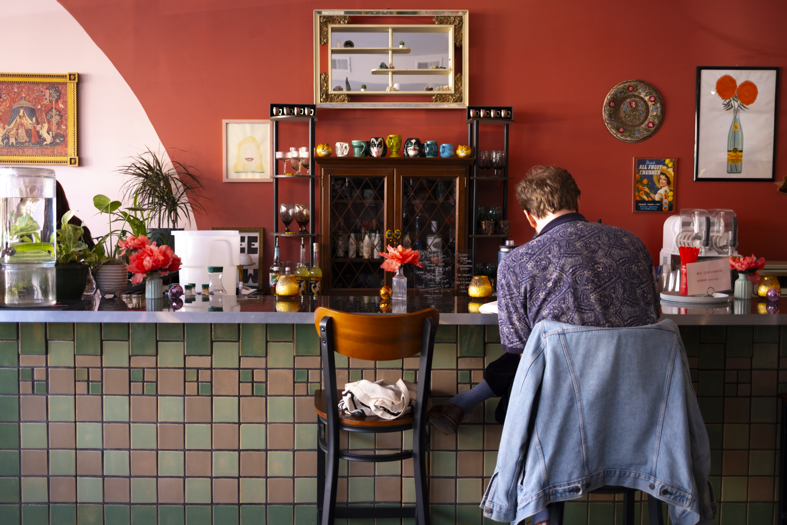
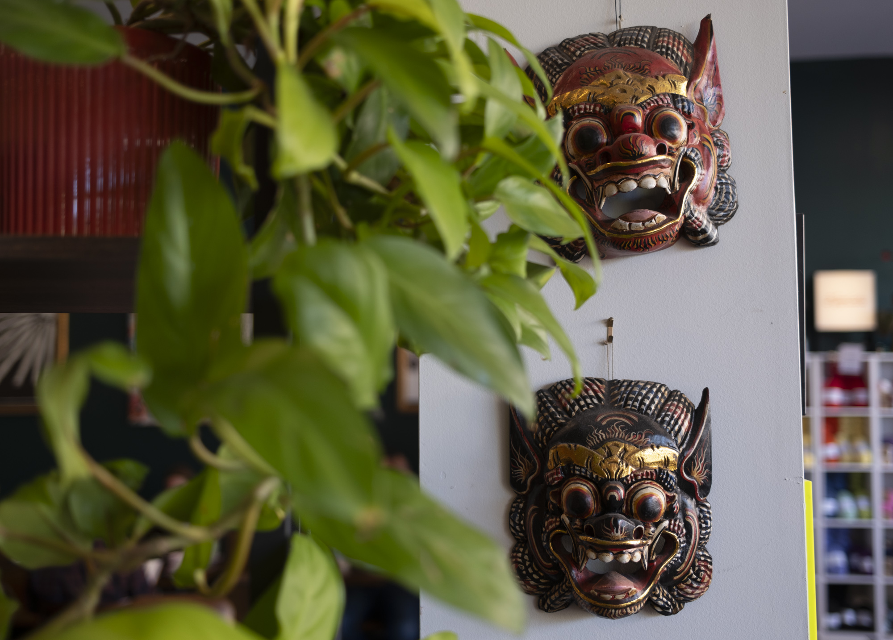
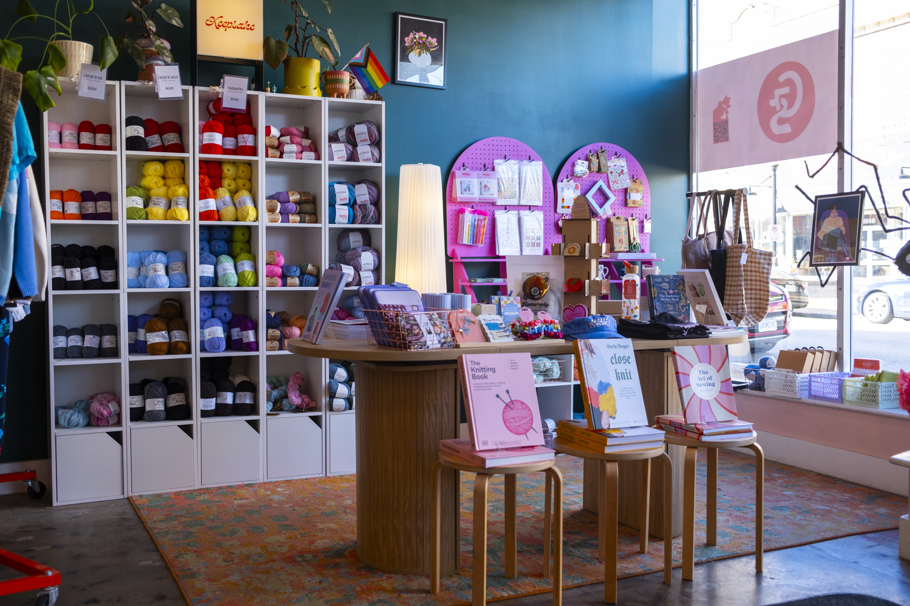
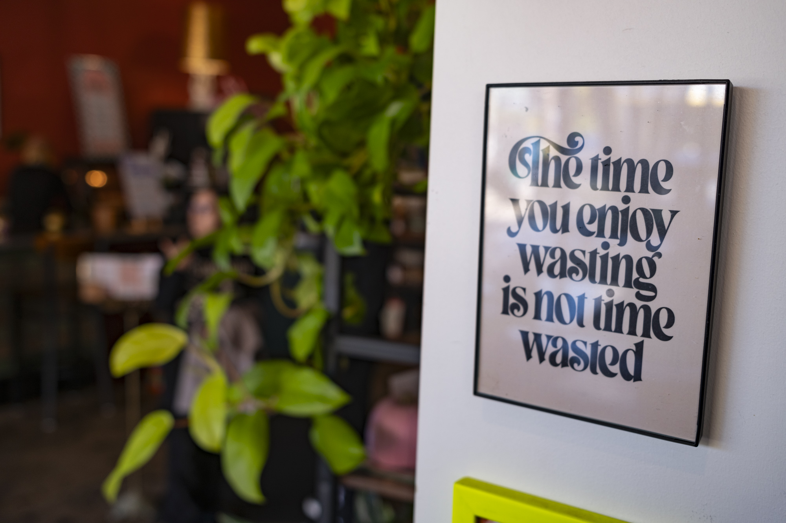

Near the corner of Cherokee St. and Jefferson Ave. you'll find Good Strangers, a cafe serving up unique lattes and small bites. It sits right at the dividing line between the west side of Cherokee St., which is full of Mexican grocery stores, taquerias, and panaderias, and the east side, which is the historic Cherokee Antique Row.

Good Strangers advertise themselves as "Midwest Tex-Mexiterrean" which is likely a brand-new genre of food, but I'm into it. The vibes inside the store are very welcoming and vibrant when I visited on a Saturday afternoon.

The cafe opened in 2020 according to the sign near their menu ("Seemed like a good idea at the time"), so I'm glad to see they weathered the pandemic storm and made it through the other side. I enjoyed hanging out here for a bit before exploring Cherokee.

It also looks like a yarn store operates out of the building, which adds to the comforting ambience.

