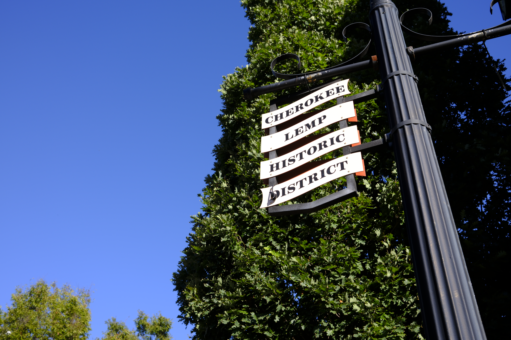
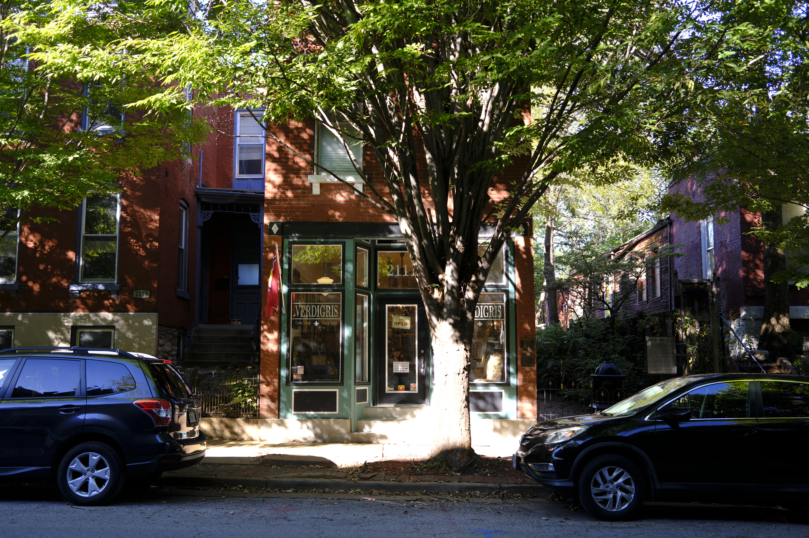
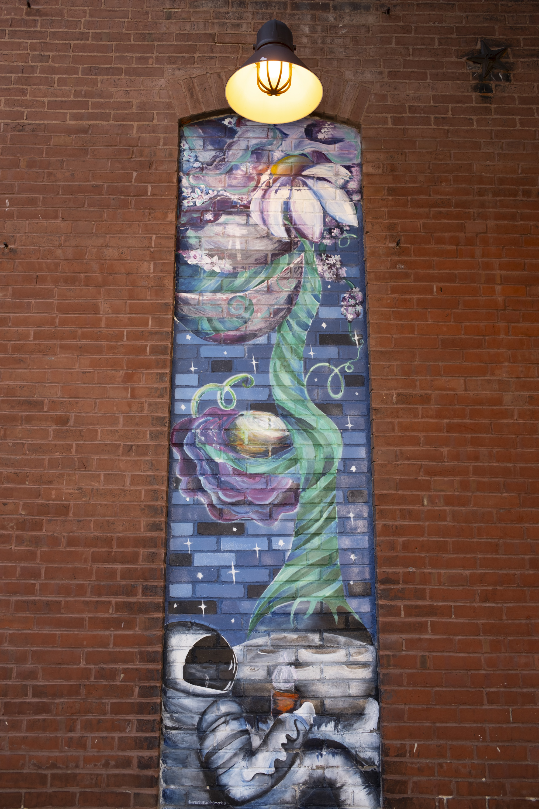
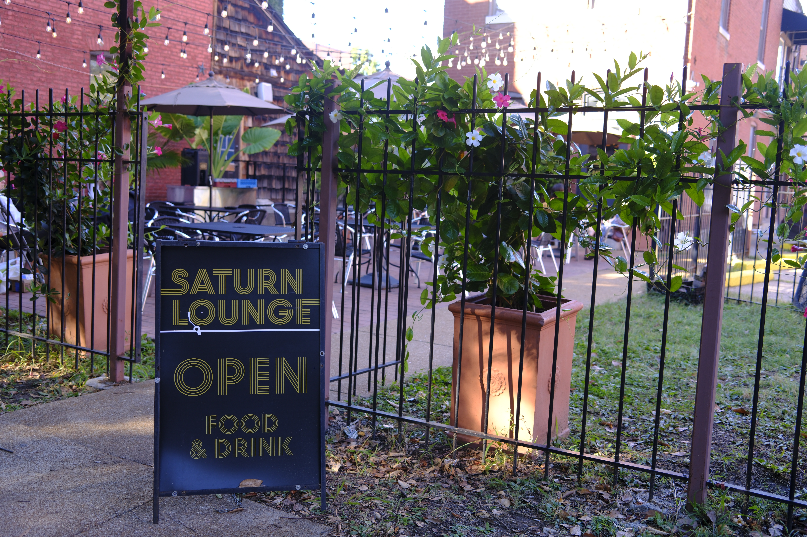
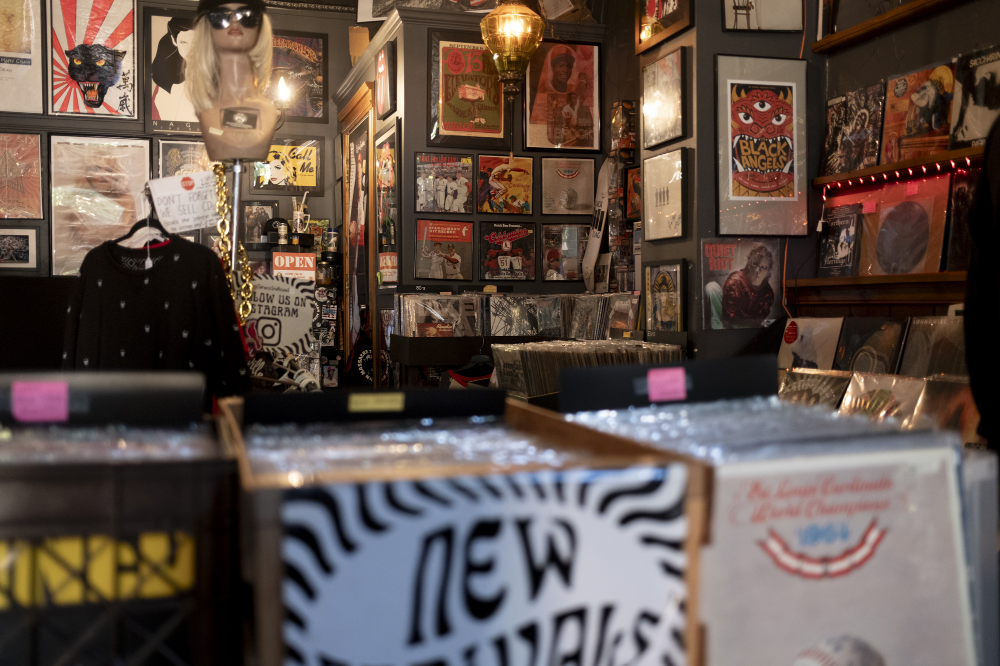
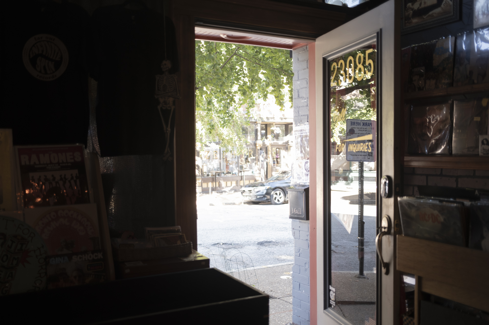
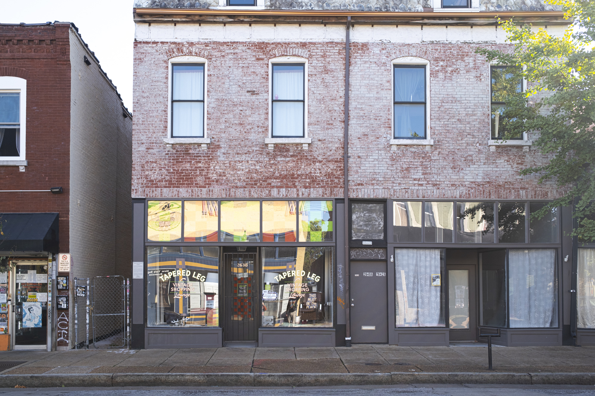
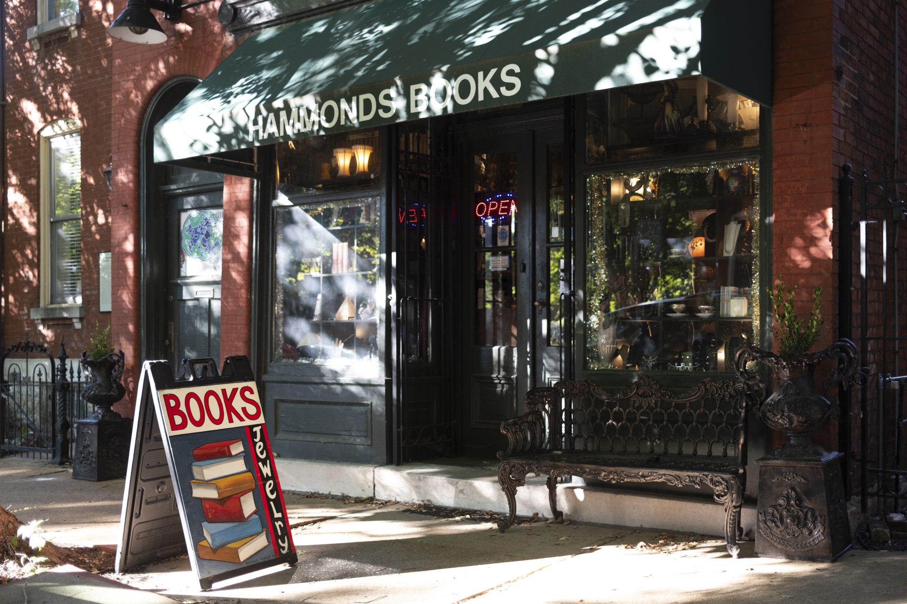
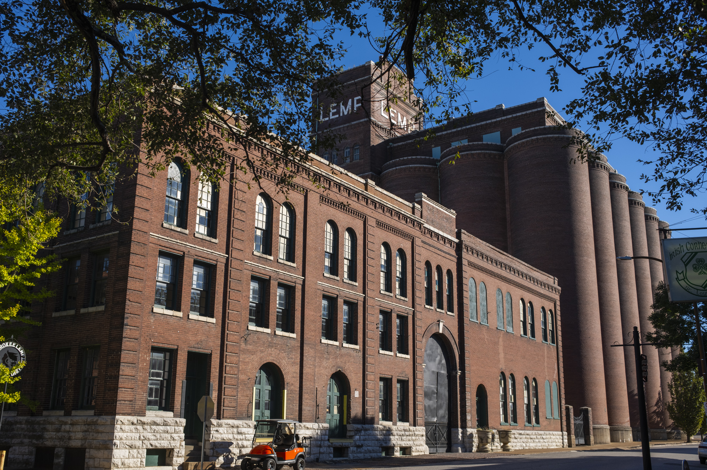
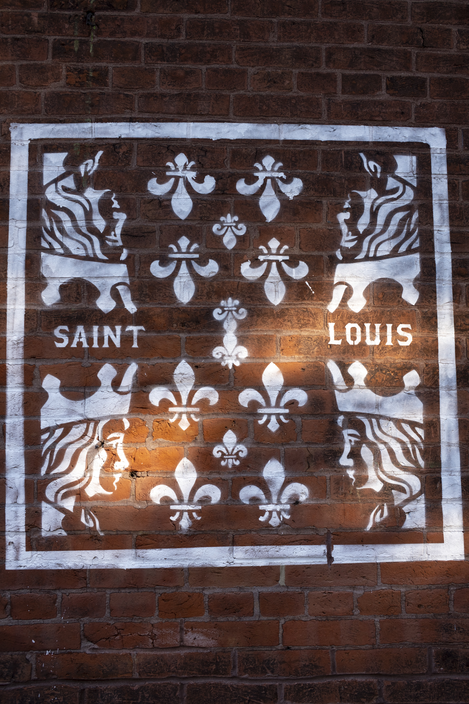

Cherokee St. is an arts district and commercial center in St. Louis. Along the western side of the street are several restaurants, panaderias, and Mexican groceries along Cherokee. Although St. Louis does not have the most significant Hispanic presence compared to other American cities, I'm glad there's a main area to go to get good Mexican food and pastries. The Cinco de Mayo festival in St. Louis also happens along Cherokee.

The eastern wing of Cherokee St. is a vintage shopping district known as the [antique row](https://cherokeeantiquerow.net/), with spots like Hammond's Antiques and Books and Elder's Antiques and a vinyl record store. This whole area is all small, family-owned storefronts with no chains and has a very eclectic, artistic vibe.

In the middle near Jefferson you'll find a few hidden gem cafes and bakeries, like [[good-strangers|Good Strangers]].

